# Maxsun B760ITX / i5-13600K / RX 6600 XT Hackintosh

铭瑄 MS-B760ITX + Intel Core i5-13600K + AMD Radeon RX 6600 XT 的 OpenCore EFI。

> 仓库名称保留了早期使用的 RX580；从 1.0.6 起，当前维护和实机验证的显卡为 RX 6600 XT。

## 当前版本 / Current release

### 1.0.8（2026-11-25）

- OpenCore：1.0.8 RELEASE
- 实测系统：macOS Tahoe 26.7.3（25G342 / Darwin 25.6.0），并保留 macOS Sequoia 15.x（Darwin 24.x）兼容路径
- SMBIOS：MacPro7,1
- 发布包：[1.0.8/EFI-OpenCore-1.0.8.zip](1.0.8/EFI-OpenCore-1.0.8.zip)
- SHA-256：`bca88d7cd79363400e7a7077690c75f983ef68ff2607906ae3d7992e6cd35606`
- 脱敏配置副本：[1.0.8/config.plist](1.0.8/config.plist)
- 校验清单：[1.0.8/SHA256SUMS](1.0.8/SHA256SUMS)
- `SimpleBCM` 扫描时间戳补丁：[1.0.8/SimpleBCM-v1.2.1-Tahoe-timestamp-fix.patch](1.0.8/SimpleBCM-v1.2.1-Tahoe-timestamp-fix.patch)

本版以实机升级并完整验证 macOS Tahoe 26.7.3（系统卷 SSV 保持原版密封、无需 OCLP 根补丁）的 EFI 为基线：

- 升级 OpenCore 到 1.0.8 RELEASE，确认全部 `.efi` 二进制与官方发布包逐文件 MD5 一致。
- 更新核心驱动：`VirtualSMC / SMCProcessor / SMCSuperIO 1.3.8`、`WhateverGreen 1.7.1`、`AppleALC 1.9.8`、`RTL812xLucy 1.1.3`（继续保留 `Lilu 1.7.3`、`RestrictEvents 1.1.7`、`CpuTopologyRebuild 2.0.2`、`HibernationFixup 1.5.5`）。
- **macOS Tahoe 无根补丁音频**：新增 `SimpleHDA.kext 1.0.2`（`MinKernel=25.0.0`），配合 `AppleALC 1.9.8`（`layout-id=66`）恢复原生 ALC897 板载音频；建议在系统中一并安装官方可选的 `SimpleHDA-HAL-1.0.2.pkg` 启用完整 AppleHDA HAL 支持。
- **macOS Tahoe 无根补丁 Broadcom Wi-Fi**：新增 `SimpleBCM.kext 1.2.1`（`MinKernel=25.0.0`，走系统原生 `IOSkywalkFamily`）；旧 OCLP 无线驱动（`AMFIPass`、`IOSkywalkFamily`、`IO80211FamilyLegacy`、`AirPortBrcmNIC`）与 `Kernel -> Block` 中的 `com.apple.iokit.IOSkywalkFamily` 规则按 `MaxKernel=24.99.99` 隔离，保留 Sequoia 启动兼容。
- **修复 Tahoe Wi-Fi 无法自动连接问题**：发布包内 `SimpleBCM.kext` 基于官方 `v1.2.1` 源码编译，仅应用 [1.0.8/SimpleBCM-v1.2.1-Tahoe-timestamp-fix.patch](1.0.8/SimpleBCM-v1.2.1-Tahoe-timestamp-fix.patch)，在 `expandScanResult()` 中利用 `mach_continuous_time()` 与 `asr_age`（偏移 `0x84`）回填 Tahoe `0x8E0` 扫描结果结构偏移 `0x8D0` 处的 `TIMESTAMP` 纳秒时间戳，修复 `WPA/WPA2` 已知网络在延迟扫描阶段因 `TIMESTAMP = 0` 被 `CoreWiFi` 判为缓存过期而无法自动连接的问题。
- **macOS Tahoe USB 端口映射**：新增符合 Tahoe `AppleUSBHostMergeProperties` 规范的 `USBPorts-Tahoe.kext`（`MinKernel=25.0.0`，补全 `usb-port-type` 与 `usb-port-number`），原 `USBPorts.kext` 通过 `MaxKernel=24.99.99` 保留给 Sequoia。
- **修复开机 ACPI 冲突报错**：禁用与未启用 `GPRW -> XPRW` 重命名补丁冲突的 `SSDT-GPRW.aml`，消除开机 `ACPI Error: [GPRW] AE_ALREADY_EXISTS` 与 `1 table load failures`。
- **保留显卡与多系统基线**：保留 RX 6600 XT 的 `agdpmod=pikera`、`gfxrst=1`、`-wegnoigpu` 与 `CFG,CFG_USE_AGDC = false`；保留 `revpatch=memtab,pci,cpuname,sbvmm`。
- **关于 SIP**：当前配置保留 `csr-active-config = 03080000`（用于本机第三方 NTFS 等内核扩展）；由于 Tahoe 无线与音频已完全无需根补丁，如无第三方未签名 kext 需求，可将 `csr-active-config` 改回 `00000000` 开启完整 SIP。
- 发布包不含 `.DS_Store`、AppleDouble 元数据及 Apple 固件更新缓存，并已通过 OpenCore 1.0.8 官方 `ocvalidate` 校验（0 issues）。

## 硬件配置 / Hardware

| 设备 | 当前配置 |
| --- | --- |
| 主板 | 铭瑄 Maxsun MS-B760ITX |
| CPU | Intel Core i5-13600K（6P + 8E） |
| 核显 | Intel UHD 770，macOS 下禁用 |
| 独显 | AMD Radeon RX 6600 XT 8GB |
| 内存 | Corsair DDR4-3200 64GB（32GB × 2，CM4X32GC3200C16K2E） |
| macOS SSD | aigo P7000Z 2TB NVMe |
| Windows SSD | KIOXIA EXCERIA G2 500GB NVMe |
| 有线网卡 | Realtek RTL8125 2.5GbE |
| 无线与蓝牙 | Broadcom BCM94360CD（Wi-Fi + BCM20702B0 USB 蓝牙） |
| 声卡 | Realtek ALC897（`layout-id=66`） |

当前为双硬盘双系统：macOS 独占 2TB aigo SSD，Windows 安装在独立的 KIOXIA SSD，由 OpenCore 统一选择启动。

## 实机验证状态 / Validation

基于 **macOS Tahoe 26.7.3（25G342）+ OpenCore 1.0.8** 实机验证：

- macOS 冷启动、重启：正常；ACPI 启动零表加载错误。
- 系统卷（SSV）保持原版密封状态，无需 OCLP Root Patch。
- CPU 拓扑与电源管理：`CpuTopologyRebuild 2.0.2` + `X86PlatformPlugin` 正常加载；传感器与风扇读数（`VirtualSMC 1.3.8` / `SMCSuperIO` / `RadeonSensor`）正常。
- RX 6600 XT 图形加速、Metal 3 与 DisplayPort 音频：正常（实测 U34G2G4R3 3440 × 1440 @ 144Hz）。
- RTL8125 2.5GbE 有线网络（`en0`）：`RTL812xLucy 1.1.3` 正常。
- BCM94360CD 无线网络（`en1`）：`SimpleBCM 1.2.1`（含时间戳补丁）开机一次自动连接成功，5 GHz 80 MHz 信道 64 速率 867 Mbps，地区码 CN，`awdl0` 正常在线。
- BCM20702B0 原生蓝牙（`HS14`）：LE 广播栈正常启动（`status = OI_OK`），Magic Trackpad 2 正常连接使用。
- ALC897 板载音频：`SimpleHDA 1.0.2` + `AppleALC 1.9.8` + `SimpleHDA-HAL-1.0.2.pkg` 四路内建输入/输出及 HAL 均已激活（`SimpleHDAHALAvailable = Yes`）。
- USB 端口映射：`USBPorts-Tahoe.kext` 全部 13 个端口正常映射与工作。

### 尚未作为“已验证”承诺的项目

- 整机自动睡眠和长时间深度睡眠未在 Tahoe 26.7.3 上完成长期压力测试。
- 当前使用 `hibernatemode 0`，不提供原生休眠/休眠镜像保证。
- AirDrop / 隔空播放 / 接力未在 Tahoe 26.7.3 上做多设备长时间大文件压测。
- 不同显示器、DP 线材、显卡 VBIOS 或 BIOS 版本可能产生不同的唤醒表现。

## 使用前必须处理三码 / SMBIOS identifiers

公开发布包不会包含本机正在使用的三码，以下字段已替换为 OpenCore 官方 Sample.plist 的无效占位值：

- `MLB`：`M0000000000000001`
- `ROM`：`112233445566`
- `SystemSerialNumber`：`W00000000001`
- `SystemUUID`：`00000000-0000-0000-0000-000000000000`

首次使用前，请使用 [GenSMBIOS](https://github.com/corpnewt/GenSMBIOS) 为 `MacPro7,1` 生成自己的信息，并写入 `EFI/OC/config.plist`。不要把正在使用的三码提交到公开仓库。

## 安装与升级 / Installation

1. 备份当前能启动的 EFI，并准备一个可恢复的 FAT32 U 盘 EFI。
2. 校验 [1.0.8/SHA256SUMS](1.0.8/SHA256SUMS)，解压 `1.0.8/EFI-OpenCore-1.0.8.zip`，将其中的 `EFI/BOOT` 和 `EFI/OC` 复制到目标 EFI 分区。
3. 写入自己的 `MacPro7,1` 三码。
4. 检查 BIOS 设置后，从 U 盘先试启动；确认 macOS、Windows 和 Recovery 都能进入，再替换硬盘 EFI。
5. 升级到 macOS Tahoe 后：
   - 如有旧版 OCLP 残留自动补丁服务（`/Library/LaunchAgents/com.dortania.opencore-legacy-patcher.auto-patch.plist` 等），建议卸载清理。
   - 如需原生 AppleHDA HAL，可在系统内安装 `SimpleHDA-HAL-1.0.2.pkg` 后重启。
6. EFI 大版本更新后，可在 OpenCore 选择器中执行一次 Reset NVRAM，再重新选择默认启动项。

## BIOS 设置 / BIOS settings

以下为当前机器使用的基础方向；不同 BIOS 版本的菜单名称可能不同：

- Hyper-Threading：Enabled
- VT-d：Disabled
- Above 4G Decoding：Enabled
- Resizable BAR：Enabled
- Serial/COM Port：Disabled
- EHCI/XHCI Hand-off：Enabled
- CSM：Disabled
- Fast Boot：Disabled
- Secure Boot：Disabled

## 主要驱动版本 / Main kext versions

| Kext | 版本 | 适用内核 | 说明 |
| --- | --- | --- | --- |
| Lilu | 1.7.3 | 全部 | 核心补丁框架 |
| WhateverGreen | 1.7.1 | 全部 | RX 6600 XT 显卡驱动修补 |
| VirtualSMC / SMCProcessor / SMCSuperIO | 1.3.8 | 全部 | SMC 与主板传感器 |
| AppleALC | 1.9.8 | 全部 | ALC897 音频布局（`layout-id=66`） |
| SimpleHDA | 1.0.2 | `>= 25.0.0` | Tahoe 原生 AppleHDA 注入（免根补丁） |
| SimpleBCM | 1.2.1（含时间戳补丁） | `>= 25.0.0` | Tahoe 原生 Skywalk Broadcom Wi-Fi（免根补丁） |
| USBPorts-Tahoe | 1.0 | `>= 25.0.0` | Tahoe `AppleUSBHostMergeProperties` USB 映射 |
| USBPorts | 1.0 | `<= 24.99.99` | Sequoia USB 映射 |
| AMFIPass / IOSkywalkFamily / IO80211FamilyLegacy / AirPortBrcmNIC | 1.4.1 / 1.0 / 12.0 / 14.0 | `23.0.0 ~ 24.99.99` | Sequoia 无线兼容路径 |
| CpuTopologyRebuild | 2.0.2 | 全部 | 13 代大小核拓扑 |
| RestrictEvents | 1.1.7 | 全部 | 内存/PCI/CPU 名称与 OTA 修复 |
| HibernationFixup | 1.5.5 | 全部 | 休眠/唤醒兼容 |
| RTL812xLucy | 1.1.3 | 全部 | Realtek RTL8125 2.5GbE |
| RadeonSensor / SMCRadeonGPU | 0.3.3 | 全部 | AMD 显卡温度传感器 |

## 历史版本 / Previous releases

### 1.0.7（2026-08-10）

- OpenCore 1.0.7 RELEASE，实测 macOS Sequoia 15.6.1（24G90），发布包：[1.0.7/EFI-OpenCore-1.0.7.zip](1.0.7/EFI-OpenCore-1.0.7.zip)（SHA-256：`c8feb233f68795aafae7160acb49f87eb4ae79269047c83493ddae902ef8974d`）。
- 为 RX 6600 XT 注入 `CFG,CFG_USE_AGDC = false`，修复双 DisplayPort 锁屏唤醒卡死问题；通过 OpenCore 1.0.7 官方 `ocvalidate` 校验。

### 1.0.6

- 更换为 RX 6600 XT。
- 支持 macOS 15.6.1 的开发版 EFI；已由 1.0.7 正式基线替代。

### 1.0.0

- 支持到 macOS 14.5。
- 修复 Type-C 音频设备识别问题。

### 0.9.5

- 调整 OpenCore 配置和 CPU 频率表现。
- 该版本的睡眠结论仅适用于当时的 RX580 和系统版本。

## 截图 / Screenshots

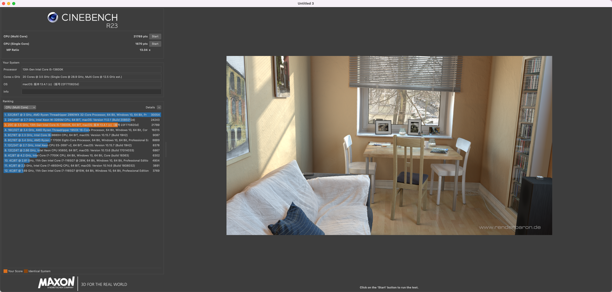
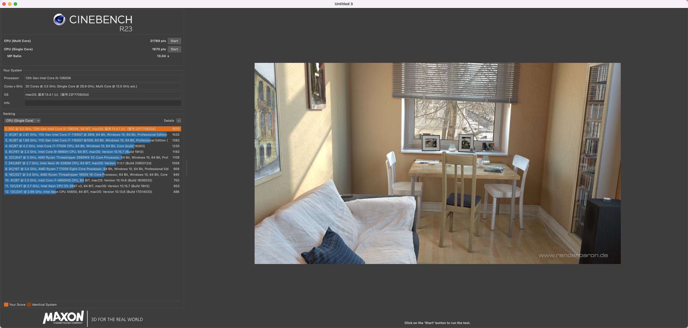
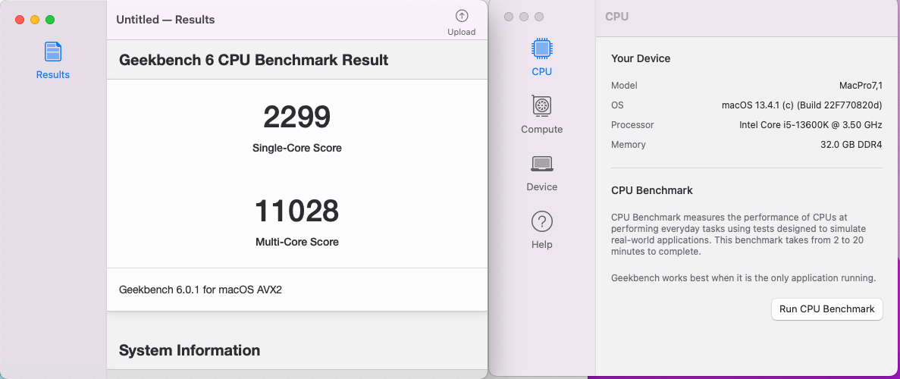
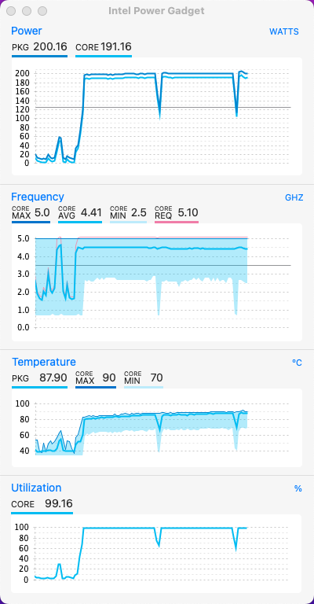
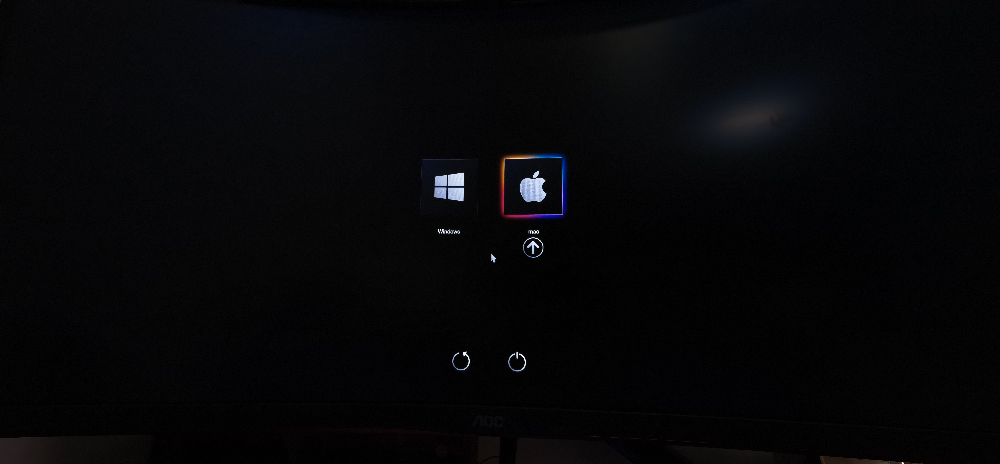
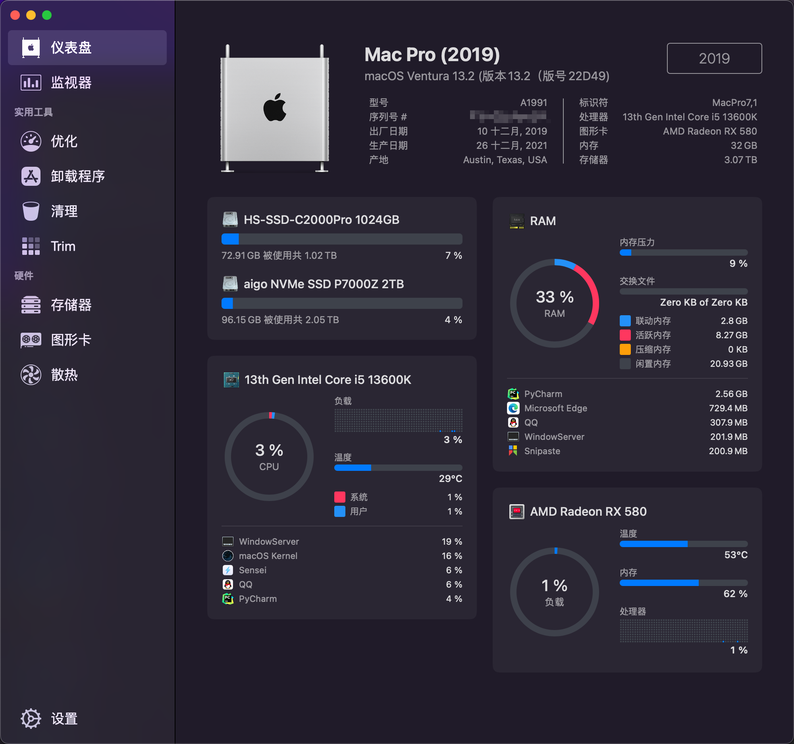
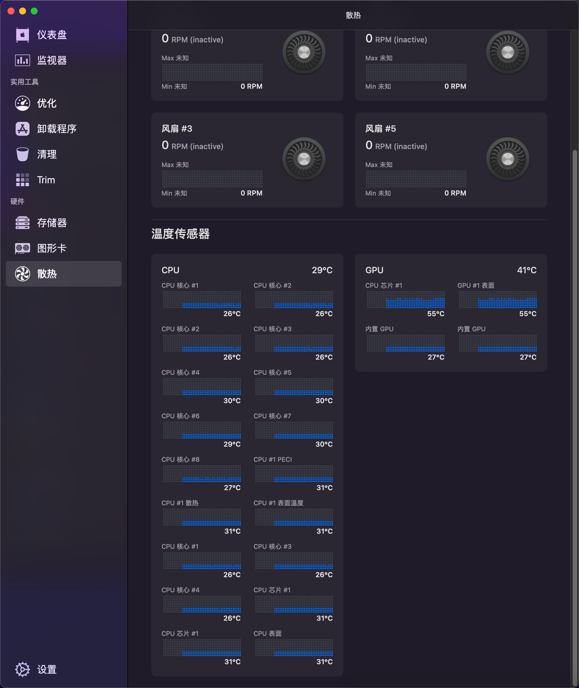
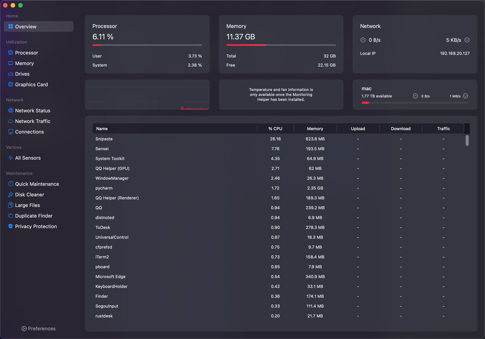
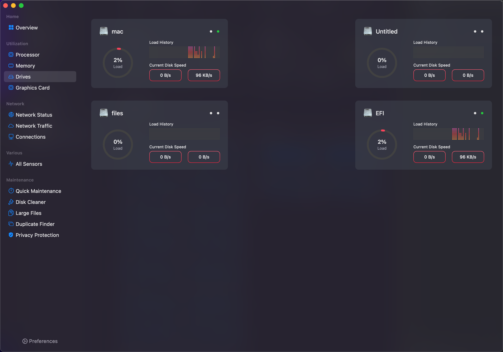
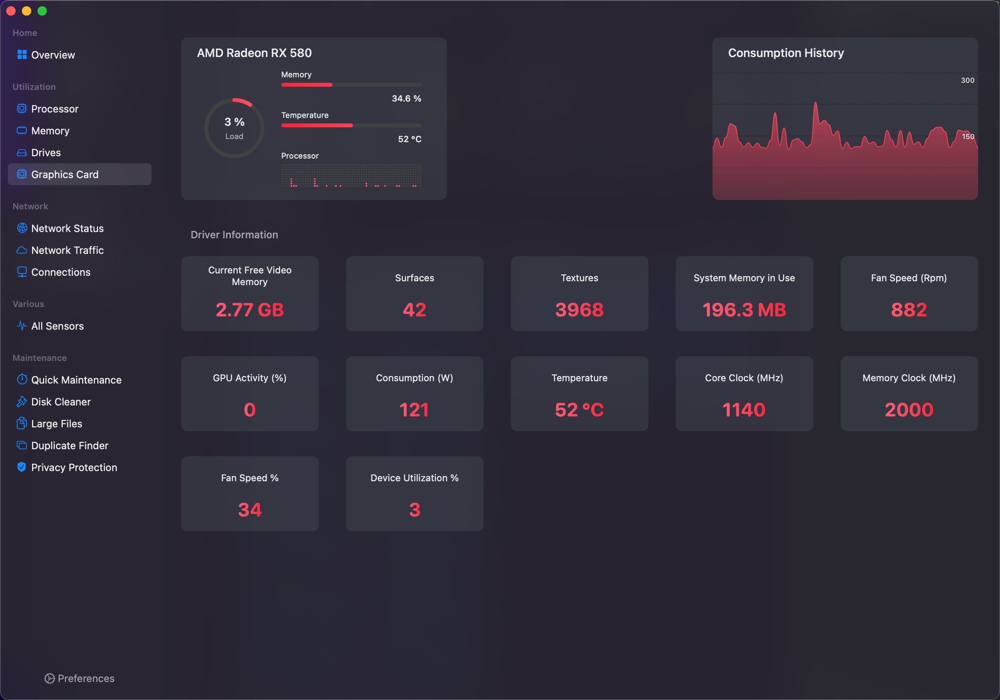
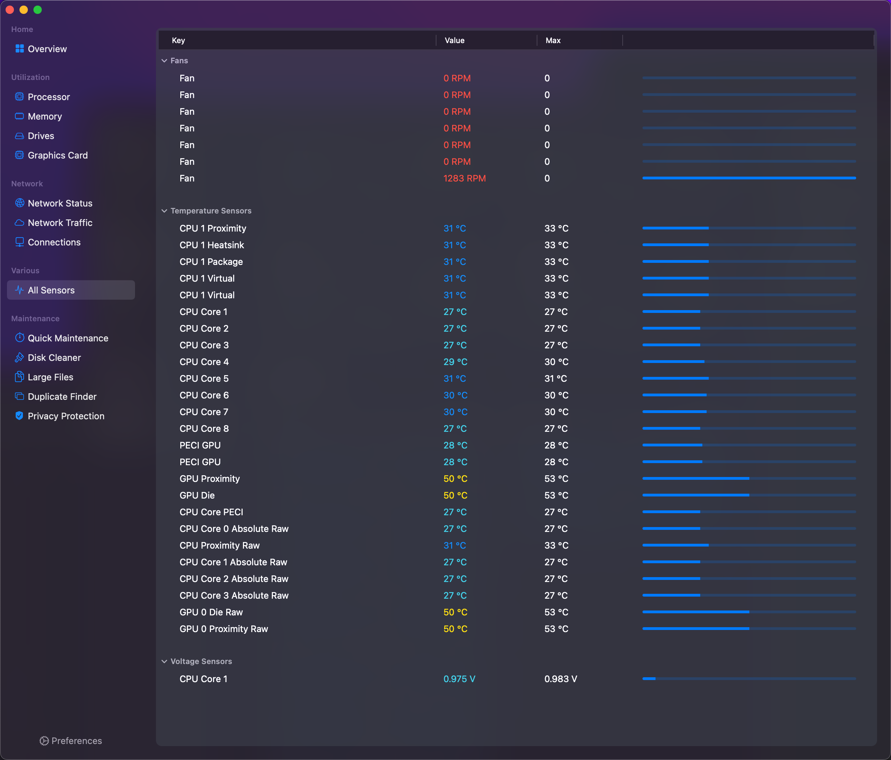
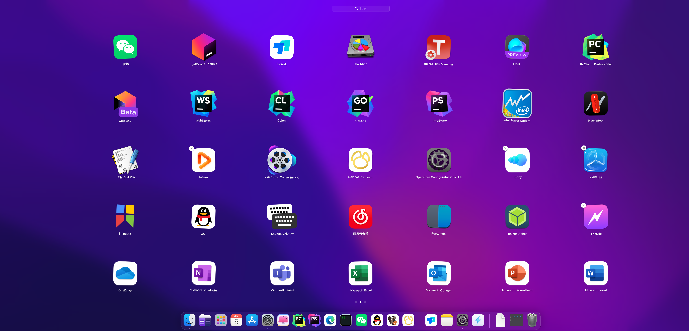
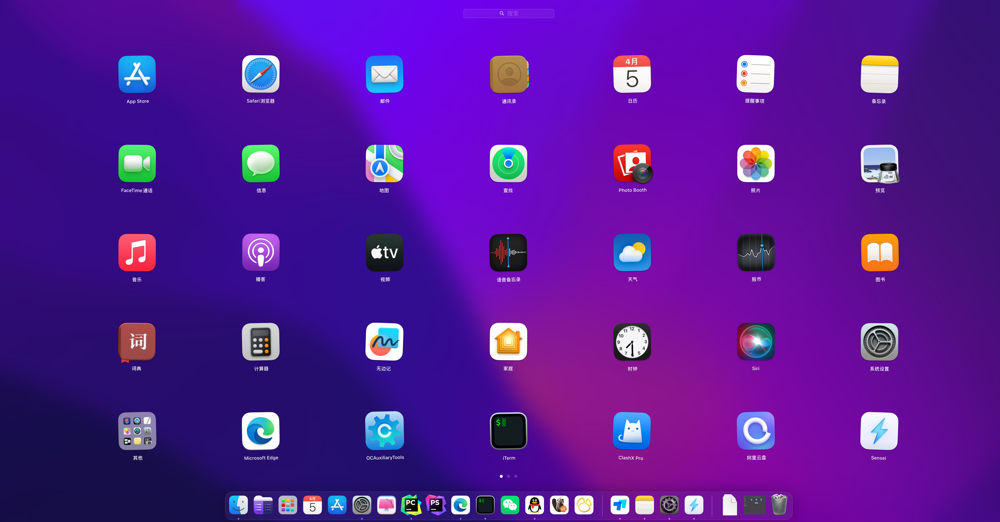
